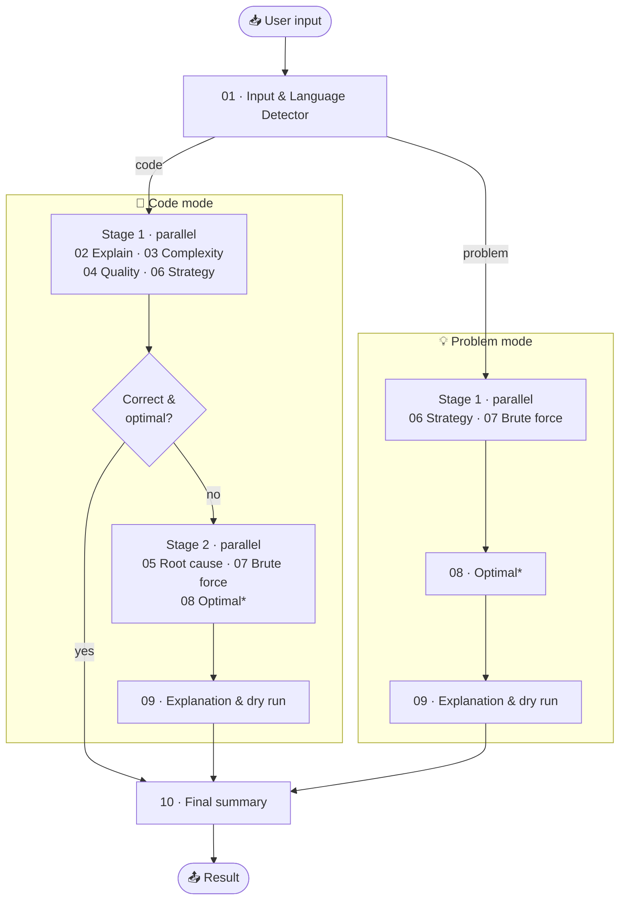

<div align="center">


# AlgoMentor

**AI-Assisted Multi-Language Code Intelligence System**

*Paste your code or describe a problem — get explanations, complexity analysis, bug diagnosis,<br>and brute-force → optimal solutions, taught step by step by a team of 10 AI agents.*


</div>

---

## ✨ Features

| | Feature | Description |
|---|---|---|
| 🧩 | **Two modes** | **Code mode** reviews your code · **Problem mode** solves a problem from plain English |
| 🌐 | **4 languages** | Python, Java, C, and C++ — detected automatically |
| 🔍 | **Code review** | Checks if your code is **correct** *and* **optimal**, and explains the root cause of bugs |
| ⏱️ | **Complexity analysis** | Worst-case time & space complexity with justification |
| 🧭 | **Strategy advisor** | Picks the right data structure and technique (hashing, two pointers, DP, BFS…) |
| 🐢➜🚀 | **Brute force → optimal** | Generates both solutions and compares them |
| 🧪 | **Dry run** | Step-by-step trace of the solution, plus edge cases |
| ✅ | **Final summary** | A complexity comparison table and key takeaway |
| 🌗 | **Modern UI** | Light/dark themes, syntax highlighting, copy buttons, mobile-friendly |

---

## 🤖 The Agent Pipeline

Instead of one giant prompt, AlgoMentor uses **10 specialized agents**, each with one narrow job.
Later agents build on earlier results, so explanations, dry runs, and complexities stay consistent
with the code actually shown. Independent agents run **in parallel**.

| # | Agent | Job |
|:-:|---|---|
| 01 | 🏷️ Input & Language Detector | Code or problem? Which language? What is the intended task? |
| 02 | 📖 Code Explainer | Explains the code with an example input/output |
| 03 | ⏱️ Complexity Analyzer | Worst-case time & space complexity |
| 04 | 🔍 Quality Judge | Is it correct? Is it optimal? Lists issues |
| 05 | 🐞 Root Cause Analyzer | Why it's buggy or slow, and how to fix it |
| 06 | 🧭 DS & Strategy Advisor | Best data structure + algorithmic strategy |
| 07 | 🐢 Brute Force Generator | Simplest correct solution (baseline) |
| 08 | 🚀 Optimal Solution Generator | Best solution using the chosen strategy |
| 09 | 🧪 Explainer & Dry Run | Core idea, why it works, dry run, edge cases |
| 10 | ✅ Summarizer | Complexity table and key takeaway |



<sub>* Agent 08 runs only when a strictly better approach than brute force exists. Otherwise the system says the brute-force approach is already optimal.</sub>

---

## 🛠️ Tech Stack

| Layer | Technology |
|---|---|
| ⚙️ Backend | **FastAPI** + **Pydantic** (Python) |
| 🧠 LLM | **Groq API** — `openai/gpt-oss-120b` (configurable) |
| 🧭 Orchestration | Python thread pool for parallel agent stages |
| 🎨 Frontend | Vanilla **HTML / CSS / JavaScript** — no framework, no build step |
| 📝 Rendering | **marked** (Markdown) · **DOMPurify** (sanitizing) · **highlight.js** (syntax colors) |

---

## 📁 Project Structure

```
AlgoMentor/
├── backend/
│   ├── main.py                  # FastAPI app — serves the API and the frontend
│   ├── config.py                # Settings (model, temperature, retries, languages)
│   ├── .env                     # Your GROQ_API_KEY (not committed)
│   ├── api/routes.py            # POST /api/analyze
│   ├── orchestrator/
│   │   └── orchestrator.py      # Runs the agent pipeline
│   ├── agents/                  # The 10 agents (one file each)
│   │   ├── agent_01_language.py
│   │   ├── ...
│   │   └── agent_10_summary.py
│   ├── llm/client.py            # Groq client, JSON parsing, error handling
│   ├── schemas/                 # Request / response models
│   └── utils/response_formatter.py
├── frontend/
│   ├── index.html               # Main app
│   ├── about.html               # About / documentation page
│   └── logo.svg                 # Logo & favicon
├── requirements.txt
└── README.md
```

---

## 🚀 Getting Started

### 1️⃣ Prerequisites
- **Python 3.10+**
- A free **Groq API key** → [console.groq.com/keys](https://console.groq.com/keys)

### 2️⃣ Install

```bash
python -m venv venv
```

```bash
venv\Scripts\activate
```
<sub>On macOS / Linux: `source venv/bin/activate`</sub>

```bash
pip install -r requirements.txt
```

### 3️⃣ Add your API key

Create `backend/.env`:

```env
GROQ_API_KEY=your_groq_api_key_here
```

### 4️⃣ Run

```bash
cd backend
```

```bash
python -m uvicorn main:app
```

Open **http://127.0.0.1:8000** 🎉

> 💡 If port 8000 is busy, run `python -m uvicorn main:app --port 8001` instead.

---

## ⚙️ Configuration

All settings are optional and go in `backend/.env`:

| Variable | Default | Description |
|---|---|---|
| `GROQ_API_KEY` | — | **Required.** Your Groq API key |
| `LLM_MODEL` | `openai/gpt-oss-120b` | Any Groq chat model |
| `LLM_TEMPERATURE` | `0.2` | Lower = more deterministic answers |
| `LLM_TIMEOUT` | `120` | Seconds per LLM request |
| `LLM_MAX_RETRIES` | `6` | Retries (waits automatically when rate-limited) |

---

## 🔌 API

### `POST /api/analyze`

```json
{
  "input": "def two_sum(nums, target): ...",
  "language": "Python"
}
```

| Field | Description |
|---|---|
| `input` | Code **or** a problem — the backend decides which |
| `code` / `problem` | Use one of these instead to force a mode |
| `language` | Optional: `Python`, `Java`, `C`, `C++` (`null` = auto) |

<details>
<summary><b>📤 Example response</b></summary>

```json
{
  "mode": "CODE",
  "language": "Python",
  "problem_statement": "Given an array nums and a target, return the indices of two distinct elements that sum to target.",
  "notes": [],
  "analysis": {
    "code_explanation": "...",
    "complexity": "...",
    "quality": { "is_correct": false, "is_optimal": false, "issues": ["..."] },
    "root_cause": "..."
  },
  "classification": {
    "category": "Array / String",
    "data_structure": "Hash Table",
    "strategy": "Hashing",
    "reason": "...",
    "better_than_bruteforce": true
  },
  "solutions": { "bruteforce": "...", "optimal": "..." },
  "solution_explanation": "...",
  "summary": "..."
}
```

</details>

| Status | Meaning |
|---|---|
| `200` | ✅ Success |
| `400` | ⚠️ Bad input (empty, too long, or unsupported language) |
| `429` | ⏳ LLM rate limit reached — wait a minute and retry |
| `502` | ❌ LLM request failed |

Interactive API docs: **http://127.0.0.1:8000/docs**

---

## 🧪 Try These

| Mode | Input |
|---|---|
| 💡 Problem | `Find the length of the longest substring without repeating characters` |
| 💡 Problem | `Given n non-negative integers representing an elevation map, compute how much water it can trap after raining` |
| 🧩 Code | A nested-loop duplicate check in Java → expect *Correct ✓ · Not optimal ✕* and an O(n) HashSet solution |
| 🧩 Code | A max-subarray in C that starts with `best = 0` → expect *Incorrect ✕* (fails on all-negative arrays) |

---

## ⚠️ Notes

- ⏳ **Rate limits:** the Groq free tier allows a limited number of tokens per minute. A full analysis
  makes up to 10 LLM calls, so wait about a minute between requests on the free tier.
- 🔒 **Privacy:** submitted code and problems are sent to the Groq API. Don't paste secrets or code you aren't allowed to share.
- 🧠 **AI output:** answers are generated by an LLM and are usually accurate, but not guaranteed.
  For important use, run the generated code to confirm it.

---

<div align="center">

Made with ❤️ for programmers who want to understand <b>why</b> an algorithm is optimal — not just copy it.

</div>
